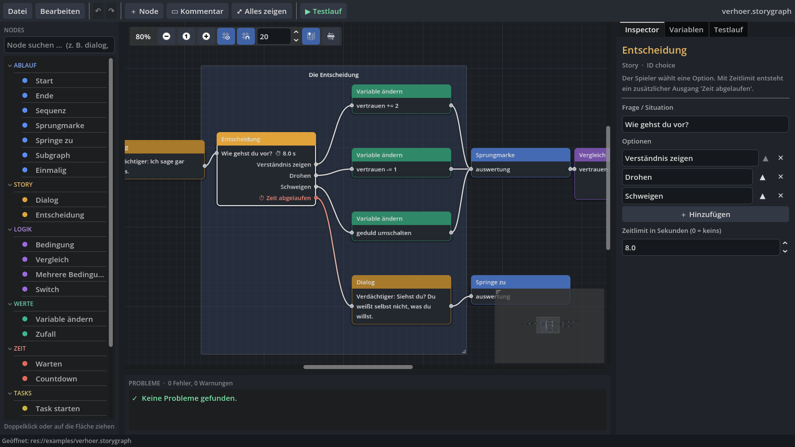
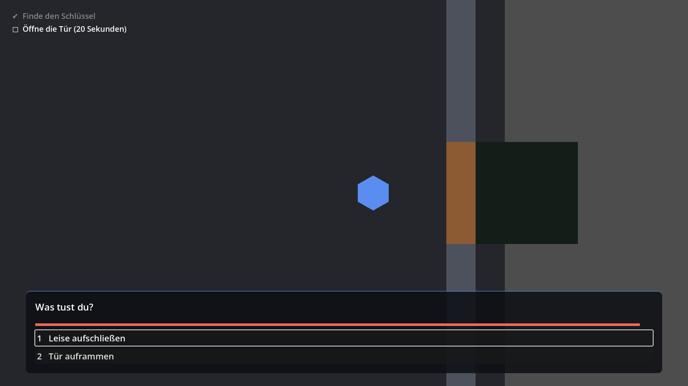

# Story Graph Editor für Godot 4.7

Ein eigenständiger Node-Editor für verzweigte, entscheidungsbasierte Geschichten im Stil von
*Detroit: Become Human* oder *Heavy Rain*, plus ein Laufzeit-Addon, das die Graphen in deinem
Godot-Spiel ausführt. Komplett in GDScript.




## Schnellstart

1. Repo klonen und den Ordner in **Godot 4.7** öffnen (Projekt importieren).
2. **F5** startet den Editor. Beim ersten Start ist ein leerer Graph offen; über
   *Datei → Beispiel öffnen (Verhör)* siehst du eine fertige Szene.
3. **F5 im Editor** (oder *▶ Testlauf*) spielt die Geschichte direkt durch. Der aktive Node leuchtet gelb.

Als eigenständiges Programm exportieren: *Projekt → Exportieren* in Godot, Vorlage für dein
Betriebssystem wählen.

## Bedienung

| Aktion | So geht's |
|---|---|
| Node hinzufügen | Rechtsklick oder **Leertaste** auf der Fläche, aus der Palette ziehen, oder Doppelklick in der Palette |
| Node direkt verbinden | Aus einem Ausgang ins Leere ziehen → Menü öffnet sich, der neue Node ist schon verbunden |
| Verbindung lösen | Rechtsklick auf den Anschluss oder Verbindung vom Eingang wegziehen |
| Bearbeiten | Node anklicken → rechts im **Inspector** |
| Kopieren / Einfügen / Duplizieren | Strg+C / Strg+V / Strg+D (geht auch zwischen zwei Editor-Fenstern) |
| Löschen | Entf |
| Rückgängig / Wiederholen | Strg+Z / Strg+Y |
| Kommentar-Rahmen | **K** – umrahmt die Auswahl; Nodes im Rahmen wandern mit |
| Alles zeigen | **F** |
| Testlauf | **F5** von Start, **Shift+F5** ab dem ausgewählten Node, **Esc** stoppt. Im Testlauf: Enter = weiter, 1–9 = Option wählen |
| Speichern | Strg+S (Format `.storygraph`, JSON) |

Unten listet **Probleme** laufend Fehler und Warnungen (fehlender Start, nicht verbundene
Ausgänge, unbekannte Variablen, kaputte Ausdrücke …). Ein Klick springt zum Node.

## Nodes

| Kategorie | Node | Zweck |
|---|---|---|
| Ablauf | Start, Ende | Einstieg und Enden (mit Enden-ID für dein Spiel) |
| | Sequenz | Mehrere Zweige nacheinander |
| | Sprungmarke, Springe zu | Große Graphen ohne Kabelsalat |
| | Subgraph | Anderen Graph (z. B. Kapitel) ausführen und zurückkehren |
| | Einmalig | Beim ersten Mal oben, danach unten |
| Story | Dialog | Sprecher + Text, Spiel ruft `advance()` |
| | Entscheidung | Optionen, optional mit Zeitlimit (eigener Ausgang „Zeit abgelaufen“) |
| Logik | Bedingung | Ausdruck wie `vertrauen >= 3 and not alarm` |
| | Vergleich | Variable mit Wert vergleichen, ganz ohne Code |
| | Mehrere Bedingungen | UND / ODER über eine Liste; NICHT per `not` |
| | Switch | Verzweigt nach dem Wert einer Variable |
| Werte | Variable ändern | setzen, erhöhen, verringern, multiplizieren, teilen, umschalten |
| | Zufall | Gewichteter Zufallsausgang |
| Zeit | Warten | Pausiert X Sekunden |
| | Countdown | „geschafft“, sobald eine Bedingung stimmt, sonst „abgelaufen“ |
| Tasks | Task starten / abschließen / warten | Ziele, auch parallel (UND/ODER) |
| Skript | Ausdruck ausführen | Beliebiger GDScript-Ausdruck (`ctx` = dein Kontext-Node) |
| | Methode aufrufen | Methode an einem Node deines Spiels; gibt sie ein Signal zurück, wird gewartet |
| | Signal senden | `custom_signal(name, daten)` für eigene Spiellogik |
| Szene | Auf Ereignis warten, Animation, Zeigen/Verstecken, Eigenschaft, Bewegen, Methode, Kamera, Sound, Szene wechseln | Spielobjekte direkt steuern (siehe unten) |

Variablen legst du im Tab **Variablen** an (wahr/falsch, Ganzzahl, Kommazahl, Text).
Umbenennen passt alle Verweise im Graph automatisch an.

## Im Spiel verwenden – ohne eigenen Story-Code



Der Editor ist nur dein Werkzeug. Dein Spiel bleibt ein eigenes Godot-Projekt und bekommt:

**1. Das Addon.** Kopiere `addons/story_graph/` in dein Spielprojekt (gleicher Pfad).
Kein Plugin aktivieren nötig; die neuen Nodes stehen danach in Godots „Node hinzufügen“-Liste.

**2. Deine Graphen.** Speichere sie mit dem Editor direkt in den Spielordner, z. B.
`MeinSpiel/story/kapitel1.storygraph`. Der Editor erkennt dann das Spielprojekt (oben rechts
„🎮 MeinSpiel · 12 Objekte · 5 Ereignisse“) und schlägt Story-IDs und Ereignisse zur Auswahl vor.
↻ liest das Projekt neu ein; das passiert auch automatisch, wenn du aus Godot zurückwechselst.

**3. Drei Bausteine in deinen Szenen:**

| Node | Wohin | Wozu |
|---|---|---|
| `StoryGraphRunner` | einmal ins Level | `graph_path` setzen, `autostart` an. Führt den Graph aus. |
| `StoryDialogueUI` | einmal ins Level | Fertige Anzeige für Dialoge, Entscheidungen (mit Zeitbalken) und Aufgaben. Klick/Enter = weiter, 1–9 = Option. |
| `StoryActor` | als Kind an jedes Objekt, das die Story steuern soll | Story-ID vergeben, z. B. `tuer`, `lampe`, `kamera_tuer`, `punkt_fenster` (Marker). |
| `StoryTrigger` | als Kind an etwas mit Signal | Meldet ein Ereignis an die Story. Unter einer Area2D/3D: Signal `body_entered`, Gruppe `player` → z. B. `kueche_betreten`. Unter einem Button: Signal `pressed`. |

**4. Im Graph steuern** (Kategorie *Szene*):

| Node | Was passiert |
|---|---|
| Auf Ereignis warten | wartet, bis ein StoryTrigger das Ereignis meldet; optional mit Zeitlimit |
| Animation abspielen | AnimationPlayer oder AnimatedSprite des Objekts, wartet optional bis zum Ende |
| Zeigen / Verstecken | `visible` an/aus |
| Eigenschaft setzen | beliebige Eigenschaft, z. B. `color`, `modulate`, `light_energy`, `position:x`, optional weich übergeblendet |
| Objekt bewegen | zum Ort eines anderen Objekts (z. B. ein Marker mit StoryActor) |
| Objekt-Methode aufrufen | z. B. `open()` an deiner Tür; gibt sie ein Signal zurück, wird gewartet |
| Kamera wechseln | macht eine Camera2D/3D mit StoryActor aktiv |
| Sound abspielen | Audiodatei abspielen |
| Szene wechseln | lädt die nächste Szene (die startet ihren eigenen Graph) |

In Bedingungen prüft `ereignis("kueche_betreten")`, ob etwas schon passiert ist.

Im **Testlauf** des Editors werden Szenen-Aktionen nur angezeigt, und erwartete Ereignisse kannst du
per ⚡ auslösen – so testest du die Story, ohne das Spiel zu starten.

**Beispiel:** `examples/level_demo/level.tscn` (in Godot öffnen, **F6**, Bewegung mit WASD).
Die ganze Abfolge – Schlüssel finden, Tür unter Zeitdruck öffnen, Kamera, Alarmlicht, zwei Enden –
steckt in `flucht.storygraph`; die Szene selbst enthält nur die Spielerbewegung als Code.

### Für Programmierer

Alles geht auch per Code, z. B. für eigene UIs oder Spielstände:

```gdscript
@onready var story: StoryGraphRunner = $StoryGraphRunner

story.dialogue_requested.connect(func(speaker, text, _id): ...)   # danach story.advance()
story.choice_requested.connect(func(prompt, options, limit, _id): ...)  # danach story.choose(i)
story.custom_signal.connect(func(name, data): ...)
story.set_var("hat_waffe", true)
story.complete_task("finde_schluessel")
story.notify_event("alarm_ausgeloest")   # oder: StoryTrigger.notify(get_tree(), "…")
var save := story.get_state()            # Spielstand; später set_state() + start(save.current_node)
```

Alle Signale und Methoden sind in
[`story_graph_runner.gd`](addons/story_graph/runtime/story_graph_runner.gd) dokumentiert.

## Aufbau

```
addons/story_graph/
  core/       Node-Definitionen, Dateiformat, Validator (von Editor und Spiel geteilt)
  runtime/    StoryGraphRunner – führt Graphen im Spiel aus
  scene/      StoryActor, StoryTrigger – verbinden Spielobjekte mit der Story
  ui/         StoryDialogueUI – fertige Dialog-/Entscheidungsanzeige
editor/       Die Editor-Anwendung (GraphEdit-basiert)
examples/     Beispielgraph und Beispielspiel
tests/        Headless-Tests
```

Neue Node-Typen: Definition in `core/node_types.gd` ergänzen (Editor-UI entsteht automatisch)
und das Verhalten in `StoryGraphRunner._execute()` umsetzen.

## Tests

```bash
GODOT=/pfad/zu/godot ./tests/run.sh                           # Laufzeit, Validator, Demo-Level-Durchlauf
godot --path . --script res://tests/ui_smoke.gd -- /tmp/shots # Editor-Rauchtest mit Screenshots
```

## Ideen für danach

- Flowchart-Übersicht wie in Detroit: welche Pfade ein Spieler genommen hat (Daten liegen schon in `history`)
- Bedingte Optionen (Option nur sichtbar, wenn Bedingung stimmt)
- Beziehungswerte zu Figuren, Lokalisierung, Live-Debugger im laufenden Spiel
