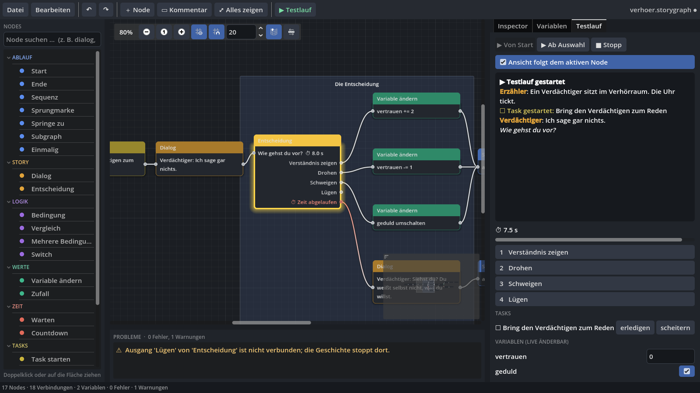

# Story Graph Editor für Godot 4.7

Ein eigenständiger Node-Editor für verzweigte, entscheidungsbasierte Geschichten im Stil von
*Detroit: Become Human* oder *Heavy Rain*, plus ein Laufzeit-Addon, das die Graphen in deinem
Godot-Spiel ausführt. Komplett in GDScript.




## Schnellstart

1. Repo klonen und den Ordner in **Godot 4.7** öffnen (Projekt importieren).
2. **F5** startet den Editor. Beim ersten Start ist ein leerer Graph offen; über
   *Datei → Beispiel öffnen (Verhör)* siehst du eine fertige Szene.
3. **F5 im Editor** (oder *▶ Testlauf*) spielt die Geschichte direkt durch. Der aktive Node leuchtet gelb.

Als eigenständiges Programm exportieren: *Projekt → Exportieren* in Godot, Vorlage für dein
Betriebssystem wählen.

## Bedienung

| Aktion | So geht's |
|---|---|
| Node hinzufügen | Rechtsklick oder **Leertaste** auf der Fläche, aus der Palette ziehen, oder Doppelklick in der Palette |
| Node direkt verbinden | Aus einem Ausgang ins Leere ziehen → Menü öffnet sich, der neue Node ist schon verbunden |
| Verbindung lösen | Rechtsklick auf den Anschluss oder Verbindung vom Eingang wegziehen |
| Bearbeiten | Node anklicken → rechts im **Inspector** |
| Kopieren / Einfügen / Duplizieren | Strg+C / Strg+V / Strg+D (geht auch zwischen zwei Editor-Fenstern) |
| Löschen | Entf |
| Rückgängig / Wiederholen | Strg+Z / Strg+Y |
| Kommentar-Rahmen | **K** – umrahmt die Auswahl; Nodes im Rahmen wandern mit |
| Alles zeigen | **F** |
| Testlauf | **F5** von Start, **Shift+F5** ab dem ausgewählten Node, **Esc** stoppt. Im Testlauf: Enter = weiter, 1–9 = Option wählen |
| Speichern | Strg+S (Format `.storygraph`, JSON) |

Unten listet **Probleme** laufend Fehler und Warnungen (fehlender Start, nicht verbundene
Ausgänge, unbekannte Variablen, kaputte Ausdrücke …). Ein Klick springt zum Node.

## Nodes

| Kategorie | Node | Zweck |
|---|---|---|
| Ablauf | Start, Ende | Einstieg und Enden (mit Enden-ID für dein Spiel) |
| | Sequenz | Mehrere Zweige nacheinander |
| | Sprungmarke, Springe zu | Große Graphen ohne Kabelsalat |
| | Subgraph | Anderen Graph (z. B. Kapitel) ausführen und zurückkehren |
| | Einmalig | Beim ersten Mal oben, danach unten |
| Story | Dialog | Sprecher + Text, Spiel ruft `advance()` |
| | Entscheidung | Optionen, optional mit Zeitlimit (eigener Ausgang „Zeit abgelaufen“) |
| Logik | Bedingung | Ausdruck wie `vertrauen >= 3 and not alarm` |
| | Vergleich | Variable mit Wert vergleichen, ganz ohne Code |
| | Mehrere Bedingungen | UND / ODER über eine Liste; NICHT per `not` |
| | Switch | Verzweigt nach dem Wert einer Variable |
| Werte | Variable ändern | setzen, erhöhen, verringern, multiplizieren, teilen, umschalten |
| | Zufall | Gewichteter Zufallsausgang |
| Zeit | Warten | Pausiert X Sekunden |
| | Countdown | „geschafft“, sobald eine Bedingung stimmt, sonst „abgelaufen“ |
| Tasks | Task starten / abschließen / warten | Ziele, auch parallel (UND/ODER) |
| Skript | Ausdruck ausführen | Beliebiger GDScript-Ausdruck (`ctx` = dein Kontext-Node) |
| | Methode aufrufen | Methode an einem Node deines Spiels; gibt sie ein Signal zurück, wird gewartet |
| | Signal senden | `custom_signal(name, daten)` für Kamera, Sound, Animation … |

Variablen legst du im Tab **Variablen** an (wahr/falsch, Ganzzahl, Kommazahl, Text).
Umbenennen passt alle Verweise im Graph automatisch an.

## Im Spiel verwenden

Kopiere `addons/story_graph/` in dein Spiel. Mehr braucht es nicht (kein Plugin aktivieren).

```gdscript
@onready var story: StoryGraphRunner = $StoryGraphRunner  # graph_path im Inspector setzen

func _ready():
    story.dialogue_requested.connect(func(speaker, text, _id):
        $UI.show_line(speaker, text))          # danach story.advance()
    story.choice_requested.connect(func(prompt, options, time_limit, _id):
        $UI.show_choices(options, time_limit))  # danach story.choose(index)
    story.task_started.connect(func(id, desc): $HUD.add_objective(id, desc))
    story.custom_signal.connect(func(name, data): print(name, data))
    story.finished.connect(func(ending): print("Ende: ", ending))
    story.start()

# Vom Spiel aus:
story.set_var("hat_waffe", true)
story.complete_task("finde_schluessel")

# Spielstand:
var save := story.get_state()
story.set_state(save); story.start(save.current_node)
```

Ein lauffähiges Beispiel ist `examples/demo_game.tscn` (in Godot öffnen, **F6**).

Alle Signale und Methoden sind in
[`story_graph_runner.gd`](addons/story_graph/runtime/story_graph_runner.gd) dokumentiert.

## Aufbau

```
addons/story_graph/
  core/       Node-Definitionen, Dateiformat, Validator (von Editor und Spiel geteilt)
  runtime/    StoryGraphRunner – führt Graphen im Spiel aus
editor/       Die Editor-Anwendung (GraphEdit-basiert)
examples/     Beispielgraph und Beispielspiel
tests/        Headless-Tests
```

Neue Node-Typen: Definition in `core/node_types.gd` ergänzen (Editor-UI entsteht automatisch)
und das Verhalten in `StoryGraphRunner._execute()` umsetzen.

## Tests

```bash
GODOT=/pfad/zu/godot ./tests/run.sh                           # Laufzeit + Validator
godot --path . --script res://tests/ui_smoke.gd -- /tmp/shots # Editor-Rauchtest mit Screenshots
```

## Ideen für danach

- Flowchart-Übersicht wie in Detroit: welche Pfade ein Spieler genommen hat (Daten liegen schon in `history`)
- Bedingte Optionen (Option nur sichtbar, wenn Bedingung stimmt)
- Beziehungswerte zu Figuren, Lokalisierung, Live-Debugger im laufenden Spiel
